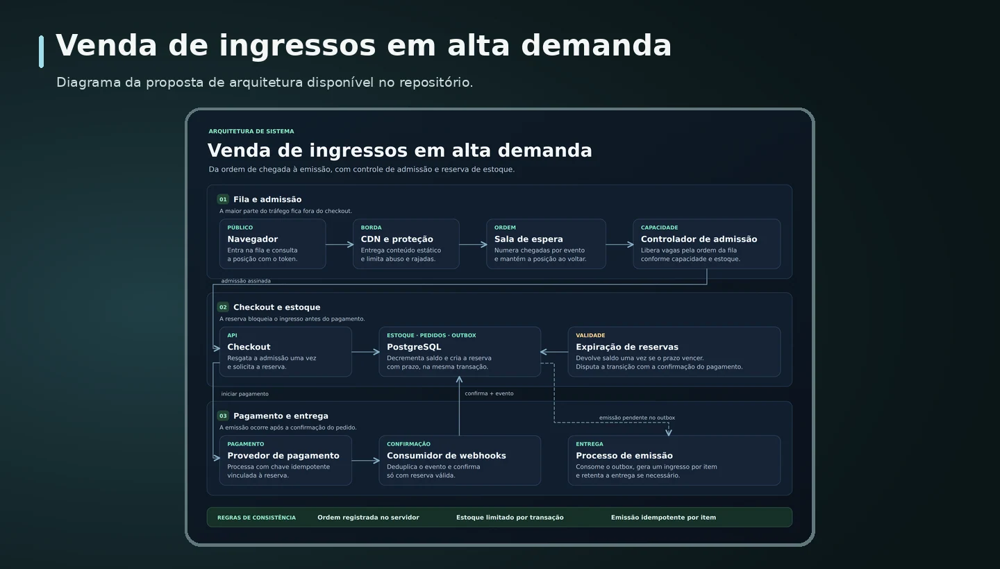

# Venda de ingressos em alta demanda

Proposta de arquitetura para distribuir acesso ao checkout por ordem de chegada, reservar estoque com consistência e retomar emissões interrompidas.

Diagrama da proposta de arquitetura disponível no repositório.

[Diagrama completo em PNG](docs/arquitetura.png) · [Versão SVG](docs/arquitetura.svg)

## Da fila ao ingresso

| Etapa | O que acontece | Garantia |
| --- | --- | --- |
| **1. Entrar na fila** | O cliente recebe um número de ordem e um token vinculado à conta e ao evento. A posição é registrada assim que o pedido chega ao servidor. Reconectar mantém a posição original. | O sistema libera vagas pela ordem registrada, sem premiar quem atualiza a página mais rápido. |
| **2. Liberar o checkout** | O controlador admite pequenos lotes conforme a capacidade do checkout e o estoque disponível. O token de acesso tem validade e pode ser resgatado uma vez. | Um pico de visitas aumenta a fila e mantém a concorrência no checkout sob controle. |
| **3. Reservar o estoque** | Em uma transação, o checkout verifica a admissão, decrementa o saldo disponível de forma condicional e cria uma reserva com prazo. | A última unidade só pode ser reservada por uma transação. Tentativas repetidas retornam a mesma reserva. |
| **4. Confirmar e emitir** | O checkout usa a reserva como referência no provedor de pagamento. A resposta autenticada atualiza o pedido e grava o evento de emissão na mesma transação. Um processo assíncrono emite o ingresso uma única vez. | O pedido só é confirmado com pagamento aprovado e uma reserva válida. A entrega do ingresso pode ser retomada após uma falha. |

## Decisões que sustentam o fluxo

**Ordem e tempo de uso.** A ordem é definida por um sequenciador durável por evento. Cada pessoa mantém o lugar ao reconectar ou ao trocar de dispositivo autenticado. Uma janela de recuperação na admissão dá tempo para o cliente abrir o checkout. Depois da reserva, todos recebem o mesmo prazo para pagar. A garantia começa quando a solicitação chega ao servidor. Atrasos anteriores a esse ponto ficam fora da ordem que o sistema consegue medir.

**Estoque sob concorrência.** O PostgreSQL é a fonte de verdade do saldo, das reservas e dos pedidos. O banco aplica o decremento com uma condição equivalente a `disponivel >= quantidade`. Se a condição falhar, nenhuma reserva é criada. Se o prazo vencer, o processo de expiração devolve o saldo uma única vez. Aprovação e expiração disputam a mesma transição da reserva no banco.

**Pagamento após o prazo.** Se a aprovação chegar quando a reserva já estiver expirada, o sistema não emite um ingresso para aquele pagamento. Registra o evento e encaminha o cancelamento ou estorno para processamento com retentativas. Notificações repetidas do provedor são deduplicadas pelo identificador do evento.

**Escala e recuperação.** CDN para conteúdo estático, consultas leves de posição com intervalo variável, proteção contra abuso e réplicas da API reduzem a carga no caminho de compra. A admissão considera a saúde do banco e do provedor de pagamento. A emissão lê os eventos do outbox com retentativas. Em caso de perda temporária da fila ou do estoque, o sistema pausa novas admissões e preserva as reservas confirmadas no banco.

## O que eu mediria

- **Justiça da fila** — ordem registrada, ordem de admissão e preservação da posição após reconexão.
- **Concorrência no estoque** — duas tentativas pela última unidade e corrida entre pagamento e expiração.
- **Recuperação** — confirmação do pagamento duplicada ou fora de ordem, interrupção da emissão e retomada dos eventos do outbox.
- **Capacidade** — taxa de admissão, latência p95 do checkout, contenção no estoque, reservas expiradas e idade do evento pendente mais antigo.

O repositório contém o desenho e as decisões da proposta de arquitetura. Os limites de admissão e os prazos dependem de medições de carga.
